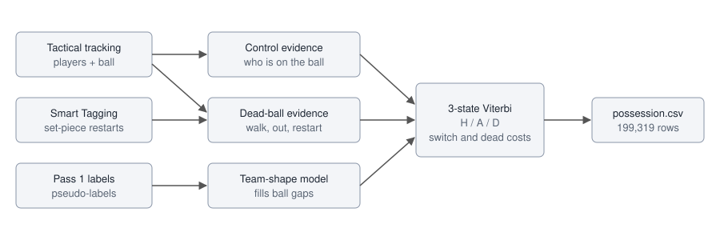

# Ball Possession Segmentation for More than a Hack 2027

An algorithmic pipeline that labels every frame of the FC Barcelona vs Athletic Club tactical video as home possession (H), away possession (A) or dead ball (D), built for Phase 1 of the More than a Hack 2027 challenge.



## Features
- Three-state H/A/D model decoded with Viterbi, so a possession only changes when the evidence pays a fixed switch cost. A touch, a deflection or a ball flying past a player does not flip the label.
- Graded control evidence from the automatic tracking: full weight within 1 m of the ball, fading to zero at 3 m, scaled by how much closer one team is than the other.
- Dead-ball detector built from collective player speed, ball out of the pitch (held until the restart), and the restarts implied by the automatic Smart Tagging set pieces.
- Self-supervised team-shape model (width, depth, territory, forward motion) that fills the 41% of graded frames where the ball is not tracked. It is trained on the pipeline's own confident frames, never on any human label.
- Fully deterministic: the same data always produces the same `possession.csv`, byte for byte.
- Ships the organisers' official scorer and validator so the output can be checked locally.

## Prerequisites
- Python 3.12 or newer (the pinned numpy 2.5.5 requires 3.12). Tested on Python 3.13, Windows 11.
- The gated match bundle from the organisers (not included, see Installation step 3).

## Installation

1. Clone the repository:
   ```bash
   git clone <repository-url> solution
   cd solution
   ```
2. Install dependencies:
   ```bash
   python -m venv .venv
   .venv/Scripts/activate
   pip install -r requirements.txt
   ```
   On macOS or Linux, activate with `source .venv/bin/activate`.
3. Provide the match data. Use one of these:
   - unpack the bundle into `./data` (`data/tactical/...`, `data/broadcast/...`), or
   - keep it in the folder that contains this repository (`../tactical/...`), or
   - point `MTAH_DATA_DIR` at it:
     ```bash
     export MTAH_DATA_DIR=/path/to/mtah2027
     ```

The data is licensed for the competition only. `.gitignore` keeps it, and every cache derived from it, out of git.

## Usage

Regenerate the submission:
```bash
python -m possession.run
```
This writes `possession.csv` (199,319 rows, `frame,label`) in a few seconds. The first run also writes a parsed cache of the tracking under `<data dir>/cache/`.

Write the file under the team name for the submission form:
```bash
python -m possession.run --out <team_name>.csv
```

Validate the file with the organisers' checks:
```bash
python evaluation/validate_submission.py possession.csv
```

Score it against the public 5-minute ground truth (a pipeline check only, never used for tuning). The ground truth file is not redistributed here; copy it from the challenge repository first:
```bash
cp <challenge-repo>/evaluation/gt/BAR-ATH_possession_gt_public* evaluation/gt/
mkdir -p evaluation/results && cp possession.csv evaluation/results/
python evaluation/run_evaluation.py
```

Ablations and self-checks:
```bash
python -m possession.run --no-shape --out evaluation/results/no_shape.csv
python -m possession.run --team-priors --out evaluation/results/team_priors.csv
python -m possession.proxy_eval evaluation/results/*.csv
```

The approach, the assets used and dropped, the possession rules and the limitations are described in [docs/TECHNICAL.md](docs/TECHNICAL.md), also provided as `docs/TECHNICAL.pdf`. To rebuild the PDF (black-and-white Mermaid diagram, needs Chrome or Edge):
```bash
pip install -r docs/requirements-docs.txt
python docs/build_pdf.py --out <team_name>.pdf
```

## Results and training metrics

Every number below is regenerated by one command:
```bash
python -m possession.report
```

How to read them:
- **There is no supervised training on this match.** The rules forbid human labels on the provided game, and we used none. The only trained component is the team-shape model (section 2), which learns from the pipeline's own pseudo-labels and is always evaluated on the half it was not trained on.
- **The final score is unknown until results day.** The ranking uses the private full-match ground truth. The public 5-minute window has only 17 possessions, so its spellF1 interval is about 0.34 wide. Those numbers show the pipeline is correct, not that one variant beats another. Variants were compared with the full-match self-checks (section 3).

### 1. The submission

| quantity | value |
|---|---|
| rows | 199,319 |
| graded frames (two halves) | 158,857 |
| H / A / D on graded frames | 55,256 / 32,792 / 70,809 |
| X (only outside the halves) | 40,462 |
| possessions | 338 |
| mean possession length | 10.4 s |
| dead-ball share of graded frames | 44.6% |
| home share of ball-alive frames | 62.8% |

### 2. Training of the team-shape model

Logistic regression on pseudo-labels from pass 1 (ball visible, one team clearly on it). Cross-fitted: the model for each half is trained on the other half only. Accuracy is measured on the held-out half.

| applied to | train frames | test frames | held-out accuracy | majority-team baseline | lift |
|---|---|---|---|---|---|
| half 1 | 15,208 | 16,382 | 86.1% | 67.5% | +18.6 pts |
| half 2 | 16,382 | 15,208 | 83.9% | 62.0% | +21.9 pts |

Standardised weights (positive means "looks like H has the ball"):

| feature | trained on half 2 | trained on half 1 |
|---|---|---|
| width difference (H minus A) | +1.340 | +1.614 |
| depth difference (H minus A) | +0.346 | +0.203 |
| block position toward A's goal | -0.183 | -0.035 |
| block forward speed toward A's goal | +0.519 | +0.205 |
| mean player speed difference (H minus A) | -0.712 | -0.484 |
| intercept | +0.712 | +1.121 |

### 3. Full-match self-checks (no ground truth)

| variant | Smart Tagging team agreement | possessions | mean length | dead-ball share |
|---|---|---|---|---|
| submission | 0.792 | 338 | 10.4 s | 44.6% |
| without team-shape model | 0.776 | 326 | 10.8 s | 44.7% |
| with team priors (dropped) | 0.857 | 324 | 11.0 s | 44.2% |

The team-priors variant uses the same Smart Tagging tags as this check, so its agreement grades its own input and is not comparable.

### 4. Public 5-minute window (organisers' metric code)

| variant | macroF1 | spellF1 | spellF1 90% interval | possessions (truth 17) | alive/dead F1 | team accuracy |
|---|---|---|---|---|---|---|
| submission | 0.8740 | 0.5176 | 0.34 to 0.68 | 17 | 0.9642 | 0.9030 |
| without team-shape model | 0.8462 | 0.4706 | 0.31 to 0.64 | 17 | 0.9648 | 0.8594 |
| with team priors (dropped) | 0.8453 | 0.4588 | 0.29 to 0.62 | 17 | 0.9663 | 0.8748 |

Submission, per class:

| class | precision | recall | F1 | support |
|---|---|---|---|---|
| H | 0.8803 | 0.8900 | 0.8851 | 3,454 |
| A | 0.8724 | 0.9205 | 0.8958 | 2,577 |
| D | 0.8999 | 0.7897 | 0.8412 | 1,469 |

Submission, confusion (rows truth, columns prediction):

| | H | A | D |
|---|---|---|---|
| H | 3,074 | 273 | 107 |
| A | 183 | 2,372 | 22 |
| D | 235 | 74 | 1,160 |

Submission, spellF1 per IoU threshold:

| IoU | 0.3 | 0.4 | 0.5 | 0.6 | 0.7 |
|---|---|---|---|---|---|
| F1 | 0.6471 | 0.5882 | 0.5882 | 0.4706 | 0.2941 |

Submission, possession changes found within a tolerance:

| tolerance | precision | recall | F1 |
|---|---|---|---|
| 12 frames (0.5 s) | 0.2000 | 0.2000 | 0.2000 |
| 25 frames (1.0 s) | 0.3000 | 0.3000 | 0.3000 |

### 5. Development history

Each version kept everything before it. The organisers' published baseline is the floor to beat.

| version | change | public macroF1 | public spellF1 | full-match possessions | Smart Tagging agreement |
|---|---|---|---|---|---|
| organisers' baseline (smooth50) | nearest player plus majority vote | 0.6207 | 0.3256 | 594 | 0.702 |
| v1 | 3-state Viterbi, hard control, first dead-ball rules | 0.6873 | 0.4000 | 315 | 0.769 |
| v2 | control no longer counts as "ball alive", windowed pass check | 0.8380 | 0.4471 | 273 | 0.788 |
| v3 | graded control (1 m full, 3 m none) | 0.8462 | 0.4706 | 328 | 0.765 |
| v4 | + team-shape model in ball gaps | 0.8738 | 0.5176 | 342 | 0.787 |
| v5, submitted | + ball held dead from leaving the pitch until the restart | 0.8740 | 0.5176 | 338 | 0.792 |

On the full match the organisers' baseline scores spellF1 0.2433 (published floor).

### 6. Sensitivity

Changing any of the main constants by about 50% moves at most 2% of graded frames:

| constant | default | tried | frames changed | possessions |
|---|---|---|---|---|
| switch cost (H to A) | 10 | 6 / 15 | 0.9% / 1.8% | 399 / 270 |
| dead-ball cost | 25 | 15 / 40 | 1.6% / 1.4% | 349 / 328 |
| control fade-out radius | 3.0 m | 2.5 m | 1.0% | 306 |
| team-shape weight | 0.05 | 0.02 / 0.10 | 1.6% / 1.3% | 328 / 344 |
| walking-speed threshold | 1.4 m/s | 1.2 / 1.6 m/s | 8.6% / 6.0% | 349 / 325 |

The walking-speed threshold is the most sensitive one: it moves the dead-ball share from 37% to 50%.

## Repository layout
```
solution/
├─ README.md
├─ LICENSE                       MIT, this repository's code
├─ LICENSE-organisers-MIT        MIT, games.py and evaluation/ from the organisers
├─ requirements.txt              pinned numpy and pandas
├─ games.py                      match constants and data paths (organisers, stays at the root)
├─ possession.csv                the submission, regenerated by python -m possession.run
├─ possession/                   the pipeline
│  ├─ run.py                     entry point, writes possession.csv
│  ├─ io.py                      read the tracking and Smart Tagging into cached numpy arrays
│  ├─ features.py                per-frame features in metres and seconds
│  ├─ model.py                   control and dead-ball evidence, Viterbi decoder
│  ├─ shape.py                   self-supervised team-shape model for ball gaps
│  ├─ proxy_eval.py              full-match self-checks that need no ground truth
│  ├─ report.py                  regenerates every metric in this README
│  └─ experimental/              tried and dropped, off by default (--broadcast)
│     ├─ align.py                broadcast-to-tactical alignment
│     └─ build_broadcast_ball.py cache the aligned broadcast ball
├─ evaluation/                   organisers' scorer and validator, unchanged
│  └─ gt/                        public ground truth: copy it in, see Usage (not committed)
└─ docs/
   ├─ TECHNICAL.md               the technical document
   ├─ TECHNICAL.pdf              the same, as submitted
   ├─ pipeline.svg               pipeline diagram used above
   ├─ build_pdf.py               renders TECHNICAL.md to PDF
   └─ requirements-docs.txt      markdown, for build_pdf.py only
```

## Contributing
Pull requests are welcome. For major changes, please open an issue first to discuss what you would like to change.

## License
Distributed under the [MIT](https://choosealicense.com/licenses/mit/) License. `games.py` and `evaluation/` come from the organisers' MIT-licensed repository (see `LICENSE-organisers-MIT`). The match data is not covered by any licence in this repository.
