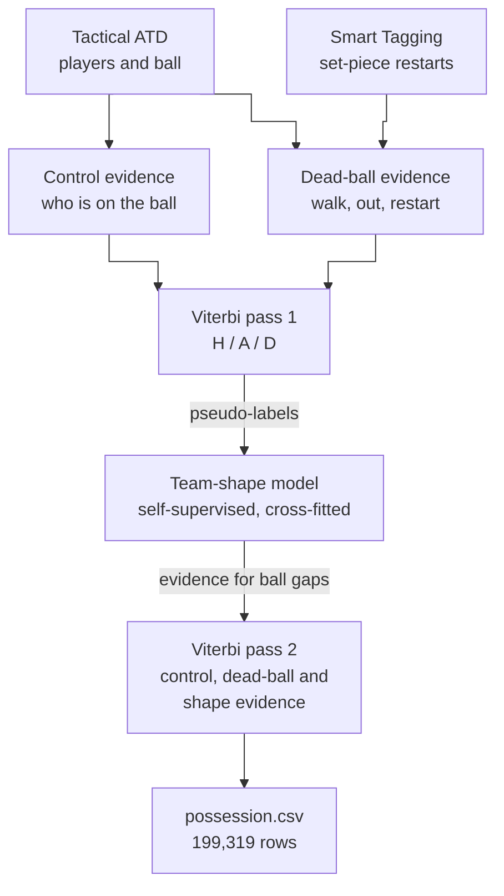

# Ball Possession Segmentation: Technical Document

More than a Hack 2027, Phase 1. Match: FC Barcelona (H) vs Athletic Club (A), LaLiga 2024-25, matchday 2.

Deliverable: `possession.csv`, one label per frame of the tactical video (199,319 rows), regenerated by `python -m possession.run`.

## 1. Approach

The task is a segmentation problem, not a per-frame classification problem. The ranking metric (`spellF1`) counts each possession once, so a system that flickers between teams loses even when most of its frames are right. Everything in the pipeline follows from that.

We model the match as a sequence of three hidden states, H, A and D, and decode it with the Viterbi algorithm. Each frame contributes evidence (a log-score) for each state. Changing state costs a fixed penalty:

| transition | cost | meaning |
|---|---|---|
| H to A, A to H | 10 | about 0.4 s of clear control by the other team is needed to switch |
| alive to dead, dead to alive | 25 | a stoppage must be supported for about a second or more |

With no evidence the decoder keeps its current state. That is exactly the challenge's rule that possession stays with the last team that had it while the ball is loose or contested. Short touches and deflections do not accumulate enough evidence to pay the switch cost.



*Figure 1. Pipeline. Pass 1 labels train the team-shape model, whose evidence is added in pass 2 on the frames where the ball gives none.*

The pipeline runs in two passes. The first pass gives labels from the ball and dead-ball evidence. Its confident frames train a team-shape model (section 4). The second pass adds the shape evidence on the frames where the ball says nothing. The run takes a few seconds and is fully deterministic.

We chose an explicit state model over a learned sequence model for three reasons. There are no labels we are allowed to train on. Every constant can be read and justified in football terms. And the transition costs directly control the quantity the metric rewards: the number and length of possessions.

## 2. Assets used and dropped

| asset | used | how |
|---|---|---|
| Tactical ATD (players and ball) | yes | control evidence, collective speed, ball out of pitch, team shape |
| ATD metadata | yes | team of each track slot, home attacking direction in the first half |
| Smart Tagging, SET PIECES | yes | restart timing, used as dead-ball evidence before the restart and alive evidence after it |
| Smart Tagging, phase team tags | tried, dropped | see section 6 |
| Broadcast ATD | tried, dropped | see section 6 |
| Homography, videos | not used | the tactical tracking is already in pitch coordinates. We had no time for our own ball detection |

## 3. Training data

No labelled data of any kind is used. Nothing comes from the provided game's ground truth, from human annotation, or from event data.

The only learned component (the team-shape model) is trained on pseudo-labels that the pipeline itself produces from the tracking: frames where the ball is visible and one team is clearly on it. It is cross-fitted. The model applied to the first half is trained on the second half, and the other way round.

The 5-minute public ground truth was used only to check the pipeline: frame alignment, label meaning, and aggregate diagnostics. No parameter was grid-searched against it and no constant is tied to a frame of the game. For transparency: two design changes were prompted by what those diagnostics showed. One was the v1 bug where a player standing over a dead ball counted as play. The other was late possession changes, which led to graded control. Both are justified on their own terms in section 4. It has 17 possessions, and the organisers' bootstrap puts its noise band at about 0.33 spellF1, so it cannot rank variants.

## 4. Possession rules implemented

**Control.** The ATD ball position lags and jitters by about a metre. For that reason control is graded, not thresholded:

- evidence is full within 1 m of the ball and fades to zero at 3 m;
- it is multiplied by how much closer the team's nearest player is than the opponent's nearest player, saturating at a 1 m margin;
- it is zero while the ball travels faster than 10 m/s (a pass or shot in flight is not controlled);
- it is zero when the ball is outside the pitch.

**Loose balls, challenges and deflections.** These produce small or mixed evidence that does not pay the switch cost, so possession stays with the last team. A change needs sustained control by the new team. The decoder places the boundary where that control begins, not where it is confirmed.

**Ball not tracked (41% of graded frames).** Short gaps up to 0.5 s are bridged linearly. Over longer gaps the team-shape model gives weak evidence. It uses five features, all smoothed over 1 s:

- difference in team width;
- difference in team depth;
- position of the block along the home attacking direction;
- forward speed of the block;
- difference in mean player speed.

A logistic regression trained on the pseudo-labels reaches 84 to 86% accuracy out of sample, against 62 to 68% for always guessing the majority team. Consecutive frames are strongly correlated, so its log-odds are discounted (weight 0.05 per frame). A switch inside a gap therefore needs several seconds of consistent shape. The evidence is applied only where control evidence is silent.

**Dead ball.** Evidence for D comes from four sources:

- the whole field walking: mean player speed under 1.4 m/s, smoothed over 2 s, counted only when no pass-speed ball (over 6 m/s) occurs within 0.5 s;
- each frame the ball is beyond the lines;
- a hold from the moment the ball leaves the pitch until it is next seen inside the lines moving at pass speed, capped at 45 s. This covers throw-ins, corners, goal kicks and goals, where the tracker often loses the ball while it is out;
- the 8 s before each Smart Tagging set-piece restart. Restart time is the tag start plus 4 s. Both kick-offs sit 3.4 s after their tag start, and the mean tracking profile around all set-piece tags is slowest about 4 s after the tag start.

Control does not count as evidence that the ball is alive, because a player standing over a ball placed for a free kick is "in control" too.

**Restarts.** After a stoppage the first sustained control decides the possessing team, as the challenge describes. Frames outside the two halves are written as `X`. We never abstain on graded frames: the scorer forward-fills `X`, and the decoder already holds its label through uncertain stretches, so `X` there would only cost macroF1.

## 5. Results and checks

| version | change | public macroF1 | public spellF1 | full-match possessions | Smart Tagging agreement |
|---|---|---|---|---|---|
| baseline_smooth50 | organisers' floor | 0.621 | 0.326 | 594 | 0.702 |
| v1 | Viterbi, hard control, first dead-ball rules | 0.687 | 0.400 | 315 | 0.769 |
| v2 | control neutral to D, windowed pass check | 0.838 | 0.447 | 273 | 0.788 |
| v3 | graded control | 0.846 | 0.471 | 328 | 0.765 |
| v4 | + team-shape evidence | 0.874 | 0.518 | 342 | 0.787 |
| v5 (submitted) | + out-of-play hold | 0.874 | 0.518 | 338 | 0.792 |

The public columns are inside the noise band and are shown as a pipeline check, not as evidence of ranking. To compare variants we relied on full-match self-checks that need no ground truth (`possession/proxy_eval.py`):

- agreement of our team with the team of Smart Tagging attacking phases. This is an independent automatic output, not human and not derived from the ground truth. It is kept out of the model so it does not grade its own input;
- the possession count and mean duration;
- the dead-ball share.

The submitted file has 338 possessions with a mean of 10.4 s, a dead-ball share of 44.6% of graded frames (typical effective playing time in LaLiga is just over half the match), and a home share of 63% of alive time.

**Sensitivity.** Changing the switch cost, the dead cost, the control radius or the shape weight by about 50% changes at most 2% of graded frames. The walking-speed threshold is the most sensitive constant: from 1.2 to 1.6 m/s, the dead-ball share moves from 37% to 50%.

## 6. Tried and dropped

**Smart Tagging phase teams as priors.** Build Up, Progression and similar phases imply a team in possession, and Defending phases imply the other team. We dropped them because phases are not possessions (the organisers say so in DATA.md), and because no independent full-match check could support them: our Smart Tagging agreement check uses the same tags, so it would only grade its own input. For transparency, the public window moved the same way (macroF1 0.874 to 0.861, 0.845 and 0.806 at weights 0.01, 0.02 and 0.05), but it cannot rank variants and was not the reason.

**Broadcast ATD.** We aligned the broadcast tracking to the tactical timeline. Each 5 s window of broadcast frames is matched to the tactical offset where every visible broadcast player has a same-team tactical player nearby. The window is tracked locally and re-acquired after cuts and replays. 838 of 902 windows aligned, with a median player mismatch of about 0.25 m. But the broadcast ball:

- filled only 9% of the graded frames where the tactical ball is missing, since both cameras lose the ball in the same situations;
- disagreed with the tactical ball by more than 5 m on 10% of shared frames.

Using it left every check unchanged and raised the possession count from 338 to 356, so it is off by default (`--broadcast` enables it).

## 7. Limitations

- **Team errors with the ball visible.** On the public window, stretches remain where a player of one team is nearest the ball while the reference gives possession to the other team. Proximity alone does not capture the reference's notion of "owning" the ball at those moments, which may change at the pass rather than at the reception. Modelling ball trajectories (where a pass starts and ends) is what we would add next.
- **Transition timing.** On the public window only 20% of possession changes are within 0.5 s. Timing at the start of a possession drives the higher IoU thresholds of `spellF1`.
- **Fouls with the ball in play.** Stoppages without the ball leaving the pitch and without a set-piece tag are detected only through collective walking. Short ones (about 5 s) are often missed.
- **Hand-set constants.** All constants are set from football reasoning rather than learned. With labelled data from other matches they could be calibrated properly. The rules allow that, and we did not have it.

## 8. Reproduction

```bash
pip install -r requirements.txt          # numpy 2.5.5, pandas 3.1.1, tested on Python 3.13
python -m possession.run                 # writes possession.csv
python evaluation/validate_submission.py possession.csv
```

The data bundle is found in `./data`, in the folder containing the repository, or at `MTAH_DATA_DIR`. Two consecutive runs produce byte-identical files.
