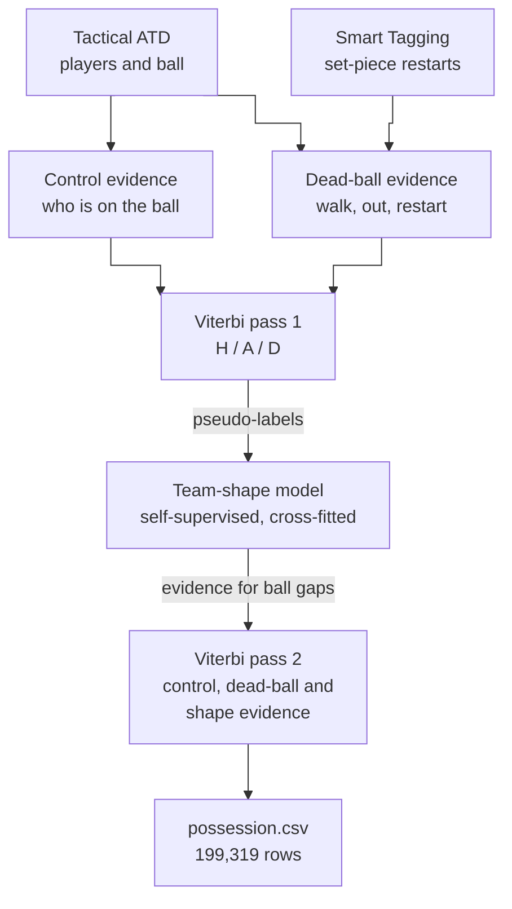

# Ball Possession Segmentation: Technical Document

More than a Hack 2027, Phase 1. FC Barcelona (H) vs Athletic Club (A), LaLiga 2024-25, matchday 2.

Our submission is `possession.csv`, one label for each of the 199,319 frames of the tactical video. Running `python -m possession.run` on the provided data rebuilds it exactly.

## 1. Approach

The first thing we noticed about the scoring was that spellF1 counts possessions, not frames. A system can be right on most frames and still do badly if it keeps flickering between teams, because every flicker invents a possession that never happened. So we treated the task as cutting the match into possessions and stoppages, and only then worried about individual frames.

We describe the match as a sequence of three states: Barcelona has the ball (H), Athletic has it (A), or the ball is dead (D). Every frame gives some evidence for each state, and a Viterbi decoder finds the most likely sequence. The key ingredient is that changing state costs something:

| change | cost | what it means in practice |
|---|---|---|
| H to A, or A to H | 10 | the other team needs about 0.4 s of clear control before we switch |
| live to dead, or dead to live | 25 | a stoppage needs support for about a second or more |

When nothing happens, nothing changes: with no evidence the decoder simply stays where it is. That is exactly the challenge's own rule, where possession stays with the last team while the ball is loose or contested. A touch or a deflection doesn't build up enough evidence to pay for a switch, so it doesn't create a new possession.



*Figure 1. The pipeline. Labels from the first pass train the team-shape model, and the second pass uses it on the frames where the ball tells us nothing.*

The pipeline runs twice. The first pass works from the ball and the dead-ball signals. Its most confident frames then train a small model of team shape (section 4), and the second pass adds that model's opinion wherever the ball can't help. A full run takes a few seconds and produces the same file every time.

Why not a learned sequence model? Mostly because there is nothing we are allowed to train it on: labels from this match are off limits. A hand-built state model has two other advantages. Every number in it means something on a football pitch, and the switching costs control exactly what the metric cares about, which is how many possessions we report and how long they last.

## 2. What we used, and what we dropped

| asset | used? | what for |
|---|---|---|
| Tactical tracking (players and ball) | yes | control, how fast the players are moving, ball out of play, team shape |
| Tracking metadata | yes | which team each track belongs to, and which way Barcelona attack in the first half |
| Smart Tagging set pieces | yes | when restarts happen: dead before, live after |
| Smart Tagging phase teams | tried, dropped | see section 6 |
| Broadcast tracking | tried, dropped | see section 6 |
| Homography and videos | not used | the tracking is already in pitch coordinates, and we didn't have time to build our own ball detection |

## 3. Training data

We didn't use any labelled data. Nothing in the pipeline comes from the match's ground truth, from human annotation or from event data.

The only part that learns anything is the team-shape model, and it learns from labels the pipeline makes for itself: frames where the ball is visible and one team is clearly on it. We train it on one half and apply it to the other, so it never judges frames it has seen.

We used the public five minutes to check that the pipeline did what we thought: frames lined up, labels meaning what we expected, and the overall statistics looking sensible. We didn't fit any parameter to them, and no constant in the code refers to a particular frame of the game. Two design changes did come out of looking at them, and we'd rather say so openly. The first version treated a player standing over a dead ball as live play, which was simply a bug. And our possession changes were arriving late, which pushed us toward the sliding-scale control described below. Both changes have their own football reasons (section 4). With only 17 possessions, the window couldn't have ranked versions anyway: the organisers' bootstrap puts its noise band at about 0.33 spellF1.

## 4. Possession rules

**Who controls the ball.** The tracked ball lags behind and wobbles by about a metre, so a hard distance cut-off misses most of a dribble. We use a sliding scale instead:

- a player within 1 m of the ball counts fully, and the evidence fades to nothing at 3 m;
- it is scaled by how much closer that player is than the nearest opponent, with full credit at 1 m closer;
- a ball moving faster than 10 m/s is a pass or a shot rather than control, so it counts for nothing;
- so does a ball outside the pitch.

**Loose balls, challenges and deflections.** These give weak or mixed evidence, never enough to pay for a switch, so the ball stays with the team that had it. A real change needs the new team to keep control for a moment. Because the decoder looks at the whole sequence at once, it places the change where that control began rather than where it became certain.

**When the ball isn't tracked.** That's 41% of graded frames. Gaps of up to half a second are filled with a straight line. For anything longer we read the teams' shape instead. A team with the ball tends to spread out while the other one closes up, so we compare the two teams on five things, each averaged over a second:

- how wide each team is;
- how deep each team is;
- where the whole block of players sits along Barcelona's attacking direction;
- how fast that block is moving forward;
- how fast each team is moving on average.

A logistic regression on these gets 84 to 86% right on the half it wasn't trained on. Always guessing the team that has more of the ball would get 62 to 68%. Neighbouring frames are almost identical, so we turn its voice down a lot (weight 0.05 per frame). That way it can only cause a switch inside a gap if the shape keeps saying the same thing for several seconds. It is only used on frames where the ball gives no control evidence.

**Dead ball.** Five signals point to a stoppage:

- everyone is walking: average player speed under 1.4 m/s (smoothed over 2 s), as long as nobody has played a pass-speed ball (over 6 m/s) in the last half second;
- the ball is over a line;
- the ball has gone out and hasn't come back yet. We count from the moment it leaves the pitch until it is next seen inside the lines moving at pass speed, for at most 45 s. This covers throw-ins, corners, goal kicks and goals, because the tracker often loses the ball while it is out;
- the half hasn't kicked off yet: every frame before Smart Tagging's "Kick Off (Start)" tag for that half is dead, with no exceptions. The second half is graded from 2,934 frames before its kick-off, and without this rule players gathering near the ball there produced a 12-second possession that never happened;
- a set piece is about to be taken: the 8 s before each restart in the Smart Tagging. We place the restart 4 s after the tag starts. Both kick-offs come 3.4 s after their tags, and across all set-piece tags the players are slowest about 4 s in.

Being close to the ball does not count as evidence that it's live. Someone standing over a free kick is "in control" too, and that was exactly the bug in our first version.

**Restarts, and when we abstain.** After a stoppage, the first team to hold the ball for a moment gets the possession, which is how the challenge describes it. We only write `X` outside the two halves. Inside them it wouldn't help: the scorer replaces `X` with the previous label anyway, our decoder already holds its label through unclear moments, and macroF1 counts an `X` as a miss.

## 5. Results

| version | what changed | public macroF1 | public spellF1 | possessions (full match) | agrees with Smart Tagging |
|---|---|---|---|---|---|
| organisers' baseline (smooth50) | the published floor | 0.621 | 0.326 | 594 | 0.702 |
| v1 | Viterbi, hard control cut-off, first dead-ball rules | 0.687 | 0.400 | 315 | 0.769 |
| v2 | standing near a dead ball no longer counts as play; pass check over a short window | 0.838 | 0.447 | 273 | 0.788 |
| v3 | sliding-scale control | 0.846 | 0.471 | 328 | 0.765 |
| v4 | team-shape model | 0.874 | 0.518 | 342 | 0.787 |
| v5 | ball stays dead until the restart | 0.874 | 0.518 | 338 | 0.792 |
| v6 (submitted) | nothing in play before a half's kick-off | 0.874 | 0.518 | 334 | 0.797 |

The public columns sit inside the noise band, so read them as "the pipeline works", not as a ranking. To choose between versions we used three checks on the whole match that need no ground truth (`possession/proxy_eval.py`):

- how often our team agrees with the team in Smart Tagging's attacking phases. That is an automatic output, made by neither a person nor the ground truth, and we keep it out of the model so it isn't marking its own homework;
- how many possessions we report, and how long they last;
- how much of the match we call dead.

The submitted file has 334 possessions averaging 10.5 s. We call the ball dead on 44.7% of graded frames, which fits with effective playing time in LaLiga being only a little over half the match. Barcelona have 62% of the live-ball time.

We also checked how fragile it is. Moving the switching cost, the stoppage cost, the control radius or the shape weight by about 50% changes at most 2% of graded frames. The walking-speed threshold is the one to watch: between 1.2 and 1.6 m/s, the share of the match we call dead goes from 37% to 50%.

## 6. Things we tried and dropped

**Smart Tagging phase teams as hints.** Phases like Build Up and Progression name a team in possession, and the Defending phases imply the other one, so it was tempting to feed them in as hints. We left them out. The organisers point out in DATA.md that phases are not possessions, and we had no independent full-match check that could back them up: our own Smart Tagging check uses the same tags, so it would only be grading its own input. For the record, the public window moved the same way (macroF1 went from 0.874 to 0.861, 0.845 and 0.806 at weights 0.01, 0.02 and 0.05), but it can't rank versions and it wasn't the reason.

**Broadcast tracking.** We hoped the TV feed would see the ball when the tactical camera didn't. First we had to line the two recordings up: for each 5-second window of broadcast footage, we looked for the tactical moment where every visible broadcast player has a tracked player of the same team nearby. We followed that match locally and searched again after cuts and replays. 838 of 902 windows lined up, with players typically about 0.25 m apart. But the broadcast ball let us down:

- it filled only 9% of the graded frames where the tactical ball was missing, because both cameras lose the ball in the same situations;
- where both had a ball, they disagreed by more than 5 m on 10% of frames.

Adding it changed none of our checks and pushed the possession count from 334 to 356, so it is off by default (`--broadcast` turns it on).

## 7. Limitations

- **The nearest team isn't always the owning team.** In the public window there are stretches where a player of one team is closest to the ball while the reference gives possession to the other. Closeness alone doesn't capture what the reference means by owning the ball at those moments. It may switch at the pass rather than the reception, for example. Following the ball's path from where a pass starts to where it ends is what we'd add next.
- **Timing.** In the public window only 20% of our possession changes land within 0.5 s of the real ones. Getting the edges right is what decides the stricter spellF1 thresholds.
- **Fouls in open play.** If the ball doesn't leave the pitch and there's no set-piece tag, we only spot the stoppage by the players walking. Short ones, around 5 s, often slip through.
- **Hand-set numbers.** Every constant comes from football reasoning rather than being learned. With labelled data from other matches, which the rules allow, they could be calibrated properly. We didn't have any.

## 8. Reproducing the file

```bash
pip install -r requirements.txt          # numpy 2.5.5, pandas 3.1.1, tested on Python 3.13
python -m possession.run                 # writes possession.csv
python evaluation/validate_submission.py possession.csv
```

The code finds the data in `./data`, in the folder that contains the repository, or wherever `MTAH_DATA_DIR` points. Two runs in a row produce byte-identical files.
